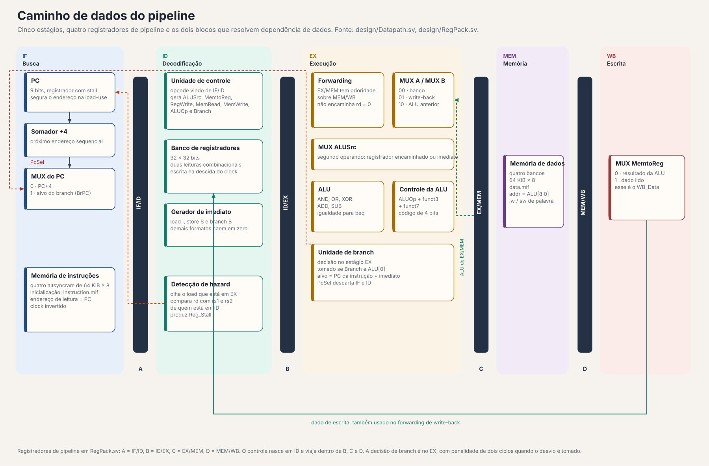
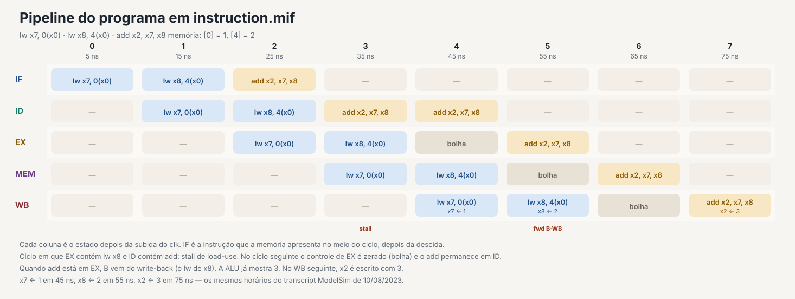
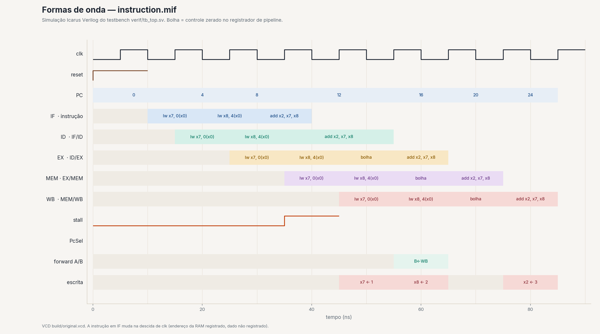
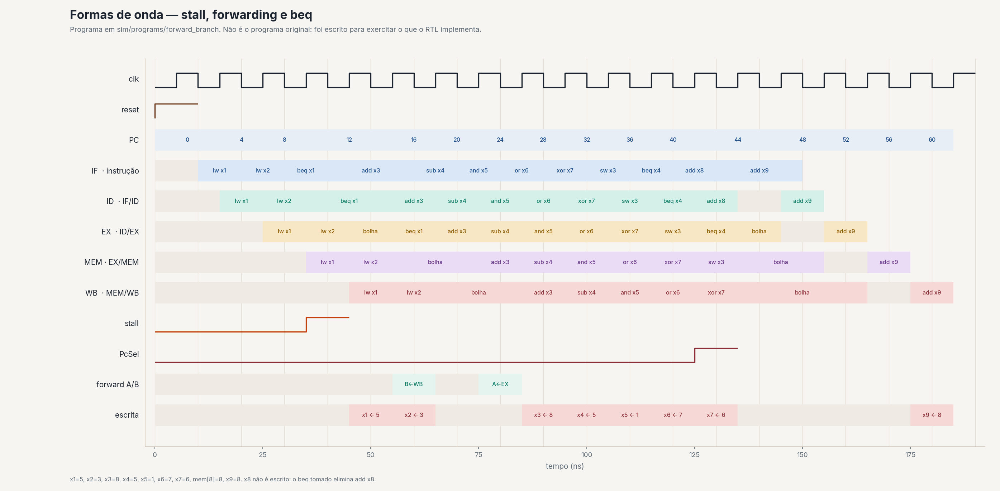

# Processador RISC-V com pipeline

[](design/Datapath.sv)
[](https://riscv.org/technical/specifications/)
[](docs/diagrams/datapath.svg)

Processador RV32 em SystemVerilog com pipeline de cinco estágios, forwarding e stall de load-use. O núcleo executa de ponta a ponta o programa gravado na memória: dois `lw` e um `add`, com `x2 = 3` no write-back.

Ian Medeiros Melo · Engenharia da Computação · CIn-UFPE

## Sumário

- [O que está neste repositório](#o-que-está-neste-repositório)
- [Contexto](#contexto)
- [Arquitetura](#arquitetura)
- [Instruções](#instruções)
- [Hazards](#hazards)
- [Simulação](#simulação)
- [Como simular](#como-simular)
- [Estrutura do repositório](#estrutura-do-repositório)
- [O que o projeto exercita](#o-que-o-projeto-exercita)
- [Referências](#referências)

## O que está neste repositório

O caminho de dados está em [`design/Datapath.sv`](design/Datapath.sv). São cinco estágios clássicos e quatro registradores de pipeline descritos em [`design/RegPack.sv`](design/RegPack.sv):

| Registrador | Estágios | Nome no RTL |
| --- | --- | --- |
| A | IF/ID | `if_id_reg` |
| B | ID/EX | `id_ex_reg` |
| C | EX/MEM | `ex_mem_reg` |
| D | MEM/WB | `mem_wb_reg` |

Há unidade de controle, controle da ALU, forwarding, detecção de hazard e uma unidade de branch que decide no estágio EX. Instruções e dados ficam em memórias separadas, cada uma com quatro blocos de 64 KiB × 8 bits gerados pelo MegaWizard da Intel (Cyclone IV GX, Quartus 16.1).

O README antigo dizia “21 funções”. O assembler lista 37 mnemônicos. No RTL, oito instruções fecham o caminho completo. A tabela [abaixo](#instruções) separa o que foi conferido no código e na simulação do que o assembler apenas aceita.

## Contexto

O projeto ModelSim se chama `ProjetoIHModelSim` e aponta para a pasta de Ianme. Os arquivos com data vão de junho a agosto de 2023: [`verif/assembler.py`](verif/assembler.py) está assinado em 16/06/2023 por Nathalia Barbosa (`@nathaliafab`), e o [`transcript`](transcript) do ModelSim é de 10/08/2023. O portfólio trata o trabalho como o projeto acadêmico de 2023.1. O repositório não nomeia a disciplina nem a equipe.

Dois arquivos trazem autoria de terceiros e não descrevem o grupo do projeto:

- `design/Memoria32.sv` e `design/Memoria32Data.sv` têm cabeçalho de Lucas Fernando da Silva Cambuim, CIn-UFPE, 20/09/2018. São o modelo de memória usado pelo núcleo.
- O assembler é o script de Nathalia Barbosa citado acima.

O fluxo original é o ModelSim – Intel FPGA Edition 2020.1, com a biblioteca `altera_mf_ver`. Este repositório também simula com Icarus Verilog 12, por meio de um modelo comportamental só de simulação da `altsyncram`.

## Arquitetura



Fonte editável: [`docs/diagrams/datapath.svg`](docs/diagrams/datapath.svg) e [`docs/diagrams/datapath.mmd`](docs/diagrams/datapath.mmd).

O clock do testbench tem período de 10 ns. PC, registradores de pipeline e o próprio estágio avançam na subida. O banco de registradores escreve na descida. A RAM recebe o clock invertido: o endereço de leitura é registrado nessa borda e o dado sai sem outro registrador, então a instrução nova aparece no meio do ciclo.

O PC tem 9 bits. O endereço de dado que sai para a memória também é `ALU[8:0]`. A macro de RAM tem 64 KiB por banco, mas o núcleo só enxerga os 512 bytes baixos.

O controle olha o opcode em IF/ID e viaja dentro de B, C e D. A ALU fica no EX e recebe `funct3`, `funct7` e `ALUOp` já registrados. O MUX de write-back escolhe só entre o resultado da ALU e o dado lido. `PC+4` e `PC+imediato` são calculados e até guardados em C e D, mas nenhum MUX os devolve ao banco. Por isso `jal`, `jalr`, `lui` e `auipc` não têm como gravar o registrador de destino mesmo que o opcode fosse reconhecido.

O banco tem 32 registradores de 32 bits e não amarra `x0` em zero. O forwarding recusa `rd = 0`, mas uma escrita em `x0` permaneceria no array.

## Instruções

O controlador reconhece quatro opcodes: `0110011` (tipo R), `0000011` (load), `0100011` (store) e `1100011` (branch). A ALU implementa AND, OR, XOR, ADD, SUB e o teste de igualdade. O gerador de imediato só monta load, store e branch.

### Fecham o caminho e foram simuladas

| Instrução | Opcode | Operação | Efeito conferido |
| --- | --- | --- | --- |
| `add` | `0110011` | ADD | `x2 ← 1+2` no programa original; `x3 ← 5+3` no programa de demonstração |
| `sub` | `0110011` | SUB | `x4 ← 8−3 = 5` |
| `and` | `0110011` | AND | `x5 ← 5∧3 = 1` |
| `or` | `0110011` | OR | `x6 ← 5∨3 = 7` |
| `xor` | `0110011` | XOR | `x7 ← 5⊕3 = 6` |
| `lw` | `0000011` | ADD no endereço | palavra de 32 bits; `funct3 = 010` |
| `sw` | `0100011` | ADD no endereço | `mem[8] ← 8` |
| `beq` | `1100011` | igualdade | não tomado quando `5 ≠ 3`; tomado quando `5 = 5`, e o `add` seguinte não escreve |

### Mesmo opcode, semântica incompleta

A classificação sai do `case` da ALU, do controlador e da memória. O programa [`sim/programs/lacunas`](sim/programs/lacunas/listing.txt) confirma as quatro primeiras linhas na simulação, com `mem[0] = 5` e `mem[4] = 3`.

| Mnemônico | O que o hardware faz | Evidência |
| --- | --- | --- |
| `sll` | a ALU não tem esse `case` e devolve 0 | `x3` escrito com 0; `5 << 3` seria 40 |
| `srl` | o controle da ALU gera o código de XOR | `x4 = 6`, que é `5 ⊕ 3`, não `5 >> 3` |
| `sltu` | o controle da ALU gera o código de AND | `x5 = 1`, que é `5 ∧ 3`; `sltu` de 5 e 3 seria 0 |
| `bne` | o branch só olha o bit de igualdade | `bne x1, x1, 8` foi tomado: `x8` não chegou a ser escrito e o alvo gravou `x9 = 10` |
| `blt`, `bge`, `bltu`, `bgeu` | mesmo caminho do `beq` | `funct3` não entra na decisão |
| `lb`, `lh`, `lbu`, `lhu` | mesmo caminho do `lw` | a memória devolve a palavra inteira; não há extensão |
| `sb`, `sh` | mesmo caminho do `sw` | os quatro bytes são escritos também no `default` |

### Aceitos pelo assembler e não ligados ao núcleo

`addi`, `andi`, `ori`, `xori`, `slti`, `sltiu`, `slli`, `srli`, `srai`, `lui`, `auipc`, `jal`, `jalr`. O opcode não gera `RegWrite` nem `ALUSrc`, o imediato cai no `default` zero, e o write-back não seleciona `PC+4`. No programa de lacunas, `addi x6, x0, 21` não produziu escrita em `x6`.

## Hazards

O forwarding está em [`design/ForwardingUnit.sv`](design/ForwardingUnit.sv). Se o `rd` de EX/MEM é o registrador fonte, não é `x0` e a instrução escreve, o operando vem do resultado da ALU. Senão, se a mesma condição vale para MEM/WB, o operando vem do dado que está indo para o banco. EX/MEM ganha de MEM/WB. O quarto código do MUX existe e apenas devolve o valor do banco.

Isso não resolve load-use. O que EX/MEM tem de um `lw` é o endereço, não o dado. O dado só fica pronto no write-back. [`design/HazardDetection.sv`](design/HazardDetection.sv) trava o pipeline quando a instrução em EX é um load e o `rd` dela aparece no campo `rs1` ou `rs2` da instrução em ID. O stall segura o PC e o registrador IF/ID e zera o controle que entra em ID/EX. Uma bolha anda para o EX.

Dois limites estão no código. O comparador não ignora `x0`, e também não sabe se aquele campo é mesmo um registrador fonte: num load, os bits de `rs2` são imediato. O campo de debug `Curr_Instr` continua sendo copiado na bolha, então uma onda crua desse campo ainda mostra a instrução que foi segurada. As figuras abaixo marcam bolha pelo controle zerado, não por esse campo.

O branch é resolvido no EX. `PcSel` vale 1 quando `Branch` está ativo e o bit 0 da ALU está em 1. Nesse caso o PC recebe `PC + imediato` e os dois estágios mais novos são descartados: IF/ID é zerado e ID/EX vira bolha. Desvio tomado custa dois ciclos. Desvio não tomado não mata ninguém.

## Simulação

O programa original, o que está em [`instruction.mif`](instruction.mif) e o que o ModelSim rodou em 10/08/2023:

```
lw x7, 0(x0)    # mem[0] = 1
lw x8, 4(x0)    # mem[4] = 2
add x2, x7, x8  # x2 = 3
```

[`verif/instructions.txt`](verif/instructions.txt) dizia `lw x7,2(x0)`. A imagem de memória, o comentário do MIF e o transcript usam deslocamento 0. O texto foi alinhado a essa imagem. Rodar o assembler com o arquivo antigo geraria outro programa.



Fonte editável: [`docs/diagrams/pipeline_timing.svg`](docs/diagrams/pipeline_timing.svg) e [`docs/diagrams/pipeline_timing.mmd`](docs/diagrams/pipeline_timing.mmd).

O `add` depende de `x8`, que ainda está em EX quando o `add` chega em ID. O ciclo de 35 ns acusa o stall. Em 45 ns o EX é uma bolha, o `add` continua em ID e `x7` recebe 1. Em 55 ns o `add` está em EX, o operando B vem do write-back e a ALU já vale 3. Em 75 ns `x2` recebe 3.



A simulação Icarus reproduz o transcript de agosto de 2023 nestes horários: leitura de `mem[0] = 1` em 35 ns, `x7 ← 1` em 45 ns, `mem[4] = 2` em 50 ns, `x8 ← 2` em 55 ns, `x2 ← 3` em 75 ns. No Icarus, o `$display` ainda imprime um 0 no mesmo instante, num delta anterior ao valor final. O transcript do ModelSim só registrou o valor que permanece, e é esse valor que o VCD mostra.

O segundo programa não faz parte do MIF original. Ele está em [`sim/programs/forward_branch`](sim/programs/forward_branch/listing.txt) para mostrar, numa única corrida, stall, forwarding, store, `beq` não tomado e `beq` tomado. A memória começa com `[0] = 5` e `[4] = 3`.



Resultado estável: `x1=5`, `x2=3`, `x3=8`, `x4=5`, `x5=1`, `x6=7`, `x7=6`, `mem[8]=8`, `x9=8`. `x8` não é escrito. O `beq x4, x1` é tomado e a bolha elimina `add x8, x1, x1`. No `beq` anterior, que não desvia, B é encaminhado do write-back. No `sub` seguinte, A é encaminhado do resultado da ALU em EX/MEM.

As ondas foram desenhadas a partir do VCD, não à mão. O script é [`sim/render_figures.py`](sim/render_figures.py).

## Como simular

### Icarus Verilog

Não usa ModelSim nem `altera_mf`. O substituto da RAM é [`sim/altsyncram.v`](sim/altsyncram.v) e só entra neste fluxo.

```bash
bash sim/run_icarus.sh
```

O script monta os programas de demonstração, compila, roda três simulações, confere os valores acima e redesenha as figuras. Requer Icarus Verilog 12 (`iverilog`, `vvp`) e Python 3 com Matplotlib. `rsvg-convert` é opcional e só exporta os PNG dos diagramas SVG.

Para uma corrida manual, a partir da raiz, com os MIF originais:

```bash
iverilog -g2012 -o build/tb.vvp sim/altsyncram.v $(sed 's/\r$//' compile_verilog)
vvp -n build/tb.vvp +vcd=build/original.vcd
```

`+vcd=` liga o dump. Sem ele, o testbench se comporta como antes e termina em `$stop`. `vvp -n` faz o `$stop` encerrar o processo.

O arquivo [`compile_verilog`](compile_verilog) lista as fontes com indentação e fim de linha Windows. O ModelSim aceita essa lista. O Icarus, não. Por isso o comando acima tira o `\r`, e o script de simulação passa os caminhos direto.

### ModelSim

O procedimento original continua em [`verif/README.md`](verif/README.md): projeto com os arquivos de `design/` e `verif/tb_top.sv`, memória `instruction.mif` e `data.mif` no diretório de trabalho, e `do runtb_top` no console. Esse fluxo carrega `altera_mf_ver` e não usa `sim/altsyncram.v`.

### Trocar o programa

1. Escreva uma instrução por linha em `verif/instructions.txt`, no formato que [`verif/assembler.py`](verif/assembler.py) documenta.
2. Rode `python3 assembler.py` dentro de `verif/`. O script gera `instruction.mif` no diretório corrente. Copie o arquivo para a raiz, que é onde a RAM procura o nome `instruction.mif`.
3. Ajuste `data.mif` se o programa lê dados.

O assembler acerta os imediatos positivos pequenos usados aqui. A rotina de sinal dele não é um complemento de dois genérico. Não vale tratá-lo como assembler de RV32I completo.

## Estrutura do repositório

```
design/                 RTL: datapath, controle, ALU, memórias, pipeline
verif/                  testbench, assembler e o programa de entrada
sim/altsyncram.v        modelo de simulação da RAM da Intel
sim/run_icarus.sh       compila, simula e confere
sim/programs/           programas extras, com listagem e MIF
docs/diagrams/          datapath e carta de tempo (SVG, PNG, Mermaid)
docs/waveforms/         ondas desenhadas a partir do VCD
instruction.mif         programa original carregado pela memória
data.mif                dados originais: palavra 1 em [0], palavra 2 em [4]
runtb_top               script do ModelSim
transcript              log do ModelSim de 10/08/2023
```

A pasta `work/` é a biblioteca compilada que já estava no repositório.

## O que o projeto exercita

O pipeline que está escrito é o de livro, com uma decisão concreta em cada hazard. O forwarding cobre a dependência de uma instrução aritmética no ciclo seguinte, e o stall existe exatamente porque um load não tem o dado nesse ciclo. O branch no EX troca um comparador simples por dois ciclos de penalidade quando o desvio é tomado. A RAM com endereço registrado e clock invertido explica por que a instrução muda na descida do clock, não na subida.

Também fica visível o que um núcleo para de fazer quando o opcode não entra no controle. O assembler e o comentário da ALU falam em tipo I, `lui` e `jal`. O MUX final e o `imm_Gen` não. A leitura que importa é a do `case`, não a do mnemônico.

## Referências

- RTL do pipeline: [`design/Datapath.sv`](design/Datapath.sv), [`design/RegPack.sv`](design/RegPack.sv), [`design/ForwardingUnit.sv`](design/ForwardingUnit.sv), [`design/HazardDetection.sv`](design/HazardDetection.sv)
- Especificação RISC-V não privilegiada: <https://riscv.org/technical/specifications/>
- Log original da simulação: [`transcript`](transcript)
- Icarus Verilog: <https://steveicarus.github.io/iverilog/>
